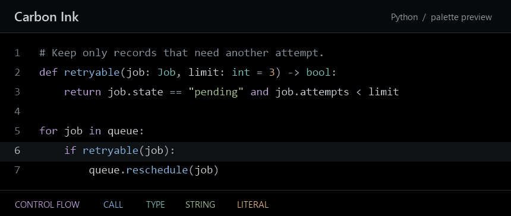

# Carbon Ink

A true-black theme for Zed. Lavender marks control flow, blue marks function calls, and seafoam marks types. Sage strings and amber literals stand apart from the soft gray used for variables and punctuation.

The editor, gutter, and terminal share a pure black background. The active line uses a subtle gray, and selected text sits on slate blue.

## Try it locally

Clone this repository. In Zed, run **zed: install dev extension** from the command palette and choose the cloned folder. Open the theme selector and choose **Carbon Ink**.
